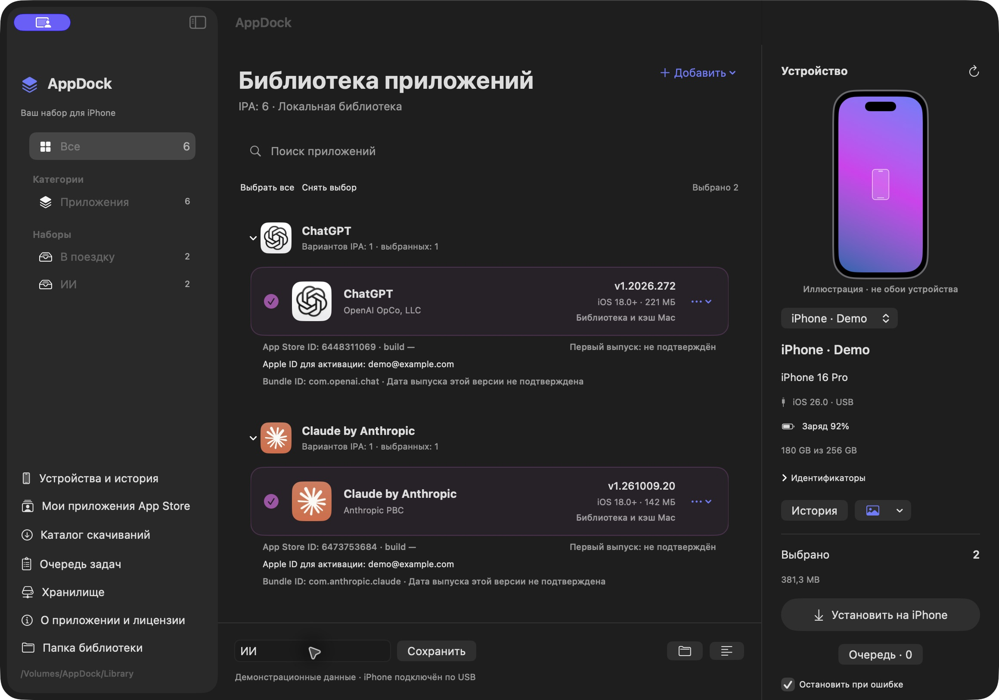
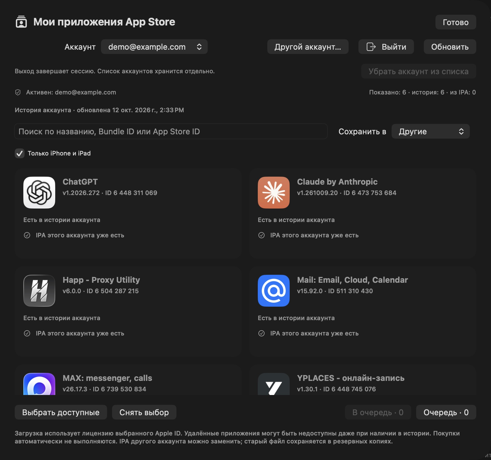
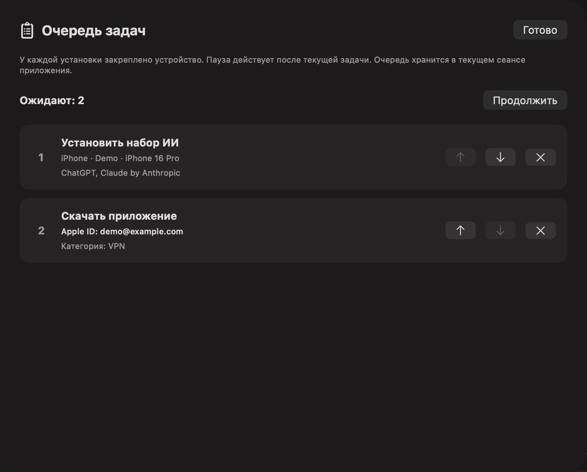
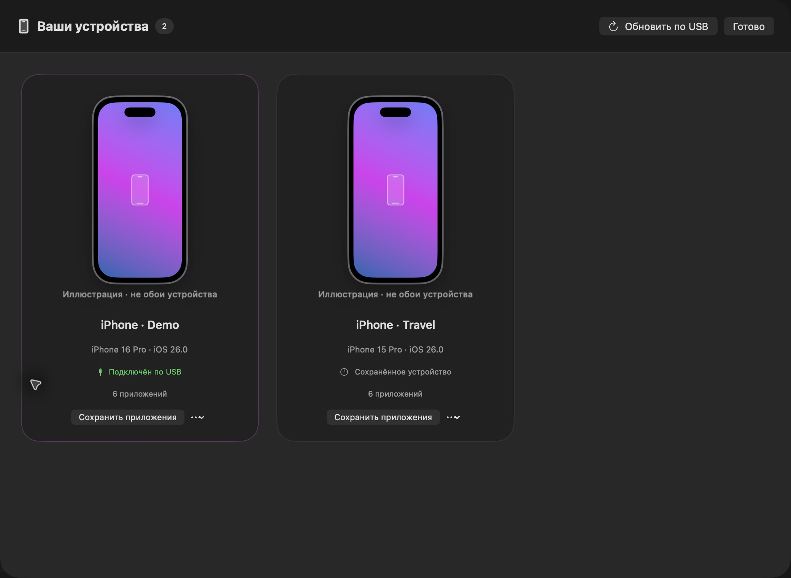

<h1 align="center">AppDock</h1>

<p align="center"><strong>Your apps. Your library.</strong><br>Save IPAs → build a preset → install over USB.</p>

<p align="center">
  <a href="https://github.com/x0rif0r/AppDock/releases"></a>
  
  
  <a href="LICENSE"></a>
</p>

[Русский](README.md) · [English](README.en.md) · [简体中文](README.zh-CN.md)

**Your personal iPhone and iPad app library on Mac.**

AppDock brings together your Apple ID purchase history, IPA downloads through ipatool, local or NAS storage, and a USB installation queue. Choose an account, find an app, save its IPA, and install it on the device you select.

[Detailed guide — Russian](docs/USER_GUIDE.md) · [Download](https://github.com/x0rif0r/AppDock/releases) · [Report an issue](https://github.com/x0rif0r/AppDock/issues) · [MIT](LICENSE)

Created by **x0rif0r**. Version **2.1.2** is a prerelease for **Apple Silicon and macOS 14+**. This README is translated; the current app interface, detailed guide, and community catalog are in Russian. English labels below describe the corresponding Russian controls.

## Screenshots

Actual interface with demonstration data. Accounts, devices, and details shown are fictional; this is not a personal library.



<details>
<summary>Purchases and accounts · Task queue · Devices</summary>

### Purchases and accounts



### Task queue



### Devices



</details>

## Compatibility

iOS 26.6.2: USB installation and launching EatsRate were tested end to end. **iOS 27: reported working by the user; the complete workflow has not been independently tested on this version.** Each IPA’s compatibility and license availability must be checked separately.

## Features

- Purchase history with icons, search, and switching between your own accounts.
- Native Mac sign-in with password and a separate 2FA prompt.
- Saved IPAs shown in gray; license owner shown in the version card when available.
- App groups, variants, versions, App Store IDs, and Bundle IDs.
- Categories and custom presets for setting up devices.
- Sequential download and installation queue, pause, task ordering, percentages, and time estimates.
- Local and NAS libraries, with a local cache for saved files when the NAS is disconnected.
- USB device selection, model, iOS version, available device details, and installation history.
- Wallpaper retrieval over USB on supported devices, or manual image selection.

## Installation

1. Download `AppDock-2.1.2-macOS-arm64.pkg` from [Releases](https://github.com/x0rif0r/AppDock/releases). The installer places **AppDock.app in /Applications**. It installs no background service and runs no dependency installation scripts.
2. Install the external tools with [Homebrew](https://brew.sh):

   ```sh
   brew install ipatool libimobiledevice ideviceinstaller
   ```

3. Check that your ipatool build supports purchase history:

   ```sh
   ipatool list-purchases --help
   ```

   Without this command, purchase history will not work. Update ipatool if necessary; availability depends on the installed build.

4. Open AppDock from Applications. The app is ad hoc signed; the package is not Developer ID signed or notarized by Apple. macOS may require you to allow this specific app in System Settings. Do not disable Gatekeeper globally.

External CLI tools and third-party IPAs are not bundled. This build does not support Intel Macs. To verify the package, download `SHA256SUMS.txt` alongside it and run the following from that folder:

```sh
shasum -a 256 -c SHA256SUMS.txt
```

Before updating, finish the queue and close AppDock, then install the new package. User libraries and history are stored separately from the app. Pending tasks exist only in the current session.

## Getting started

### Apple ID and purchase history

Open **Мои приложения App Store → Другой аккаунт…** (My App Store apps → Another account). Enter your Apple ID, password, and 2FA code when prompted. Use the account listed under **Media & Purchases** on the iPhone; it may differ from your iCloud account. AppDock does not change the system iCloud account.

History is loaded in pages and cached separately for each account. Saved IPAs missing from Apple's response can supplement the list with a separate saved-IPA label. You can browse another account's cached history, but downloading requires an active sign-in to that account. Account switching is disabled while tasks are running or pending.

Check **Активен** (Active) or **Сессия подтверждена** (Session verified), not just the selected account name. A 2FA prompt means ipatool is waiting for a code; it does not confirm delivery of a notification or SMS. Canceling sign-in does not activate the requested account.

**Sign out:** click **Выйти**. This revokes the current ipatool session while keeping saved IPAs and history. To remove an inactive account from the picker, select it and click **Убрать аккаунт из списка** (Remove account from list). Signing in again restores the account and its cached history. Sign-out is unavailable while tasks are running or pending.

Find an app, select a category, and click **Скачать** (Download), or queue several apps. IPAs already saved for the same account appear gray in the purchase catalog. In the library, use the version menu to update or replace an IPA. The previous file is backed up when replaced.

### Local and NAS storage

Open **Хранилище** (Storage), choose Local or NAS, and select a folder. For NAS, mount the network share in Finder first, for example over SMB. Downloads run on the Mac and are saved to the selected folder; there is no remote server mode.

Each mode remembers its own folder. Selecting a new folder does not automatically move the old library. Before installation, the IPA is copied to the local cache and checked. Previously cached copies can be used with the NAS disconnected.

### USB installation

1. Connect the iPhone, unlock it, and trust the Mac.
2. Select the target device and the apps or preset you want.
3. Click **Установить на iPhone** (Install on iPhone). The task retains the selected device.
4. Monitor the queue. Pausing takes effect after the current operation.

History is saved per device. By default, an app is skipped if the device already has the same or a newer version. **Переустановить такую же версию** (Reinstall the same version) allows another transfer of the same version without first deleting the app. A newer installed version is always skipped. The setting is retained by the queued task.

Time estimates are approximate. Checks and archive processing continue after the download reaches 100%.

## Saving apps from an old iPhone

Open **Устройства и история** (Devices and history), choose the iPhone, and select **Сохранить с iPhone** (Save from iPhone). Read the installed apps over USB, select the apps with resolved IDs, and queue their downloads.

AppDock matches exact Bundle IDs against the selected account's history, your library, and the bundled community catalog. A numeric ItemID is used if the device exposes it. Unresolved or conflicting IDs are never downloaded automatically. The version Apple provides may differ from the version installed on the old phone. Turn off **Только найденные ID** (Resolved IDs only) to view unresolved apps as well.

After downloading, click **К установке · N сохранённых** (Prepare installation · N saved). This selects saved IPAs in the currently filtered list and creates a preset named after the device and search query. The count is visible before clicking; searching for one app does not select the rest of the phone's apps. Connect the target iPhone, select it in the main window, and start installation. The complete library remains available in the main window.

Selecting another cached account opens sign-in with its identifier filled in. ipatool maintains one active session; AppDock does not silently restore separate sessions for every account. A download requested for an inactive account can be queued after successful sign-in. AppDock does not save passwords.

**Проверить App Store** (Check App Store) checks the public Russian storefront only. It does not check license ownership or prove removal worldwide. If a known ID is absent there and missing from the community catalog, **Предложить в каталог…** opens a draft GitHub issue. Add an official source and submit it yourself. The draft excludes your account, serial number, and UDID.

**Забыть устройство** (Forget device) removes its card and installation history after confirmation. It does not affect the phone or library IPAs. A connected device will be discovered again on the next scan.

## Apple licenses and limitations

Purchase history does not guarantee that a removed app can be downloaded again. Apple may refuse to provide a license or file. AppDock does not make purchases automatically, remove DRM, re-sign IPAs, or transfer licenses between Apple IDs.

An installed app may request the account that owns its license. The version card shows that account when it is present in the IPA metadata. Buying an app on one account does not authorize free activation on another account.

CRC, SHA-256, App Store ID, and Bundle ID checks detect corruption and mismatches; they do not prove that a banking app is authentic. Successful installation does not guarantee launch, service availability, or compatibility with a particular iOS version. Icons come from your IPAs or checked Apple metadata; a placeholder is used when unavailable.

## Device images

Device cards show saved images. For actual Lock Screen clocks and widgets, take a screenshot on the iPhone, transfer it to the Mac, and choose **Экран блокировки → Импортировать снимок** (Lock Screen → Import screenshot) from the device menu.

USB screenshots require the screenshotr service. It was unavailable on the tested iPhone without a developer image. AppDock does not enable Developer Mode or change phone settings. The preview is a saved image, not a live display. Wallpaper retrieval is separate and does not include Lock Screen clocks or widgets.

## Data and privacy

- Passwords and 2FA codes are passed to the local helper through stdin/PTY, never process arguments. AppDock does not write them to files or logs.
- ipatool stores its authorized session in macOS Keychain. There is one active session, not independent stored sessions for all accounts.
- Account emails, purchase history, device information, images, and caches are stored **locally** in `~/Library/Application Support/IPAOrganizer`. The legacy path is retained for compatibility.
- IPAs and library metadata live in the chosen Local/NAS folder. Metadata may contain the license owner's Apple ID; configure access to the network folder accordingly.
- The app uses Apple services, App Store downloads, and external CLI tools. AppDock has no server of its own.
- This repository and its releases contain no user IPAs, accounts, purchase history, device reports, wallpapers, or tokens.

## Troubleshooting

| Problem | What to check |
| --- | --- |
| `license is required` or app unavailable | The active Apple ID and prior acquisition. Even an existing license may not allow redownloading a removed app. |
| iPhone requests the purchasing account | Check the Apple ID in the IPA version card. Licenses do not transfer between accounts. |
| No connected device | Cable, unlock state, trust confirmation, and libimobiledevice installation. |
| Missing purchase history | Your ipatool build's `list-purchases` support and active authorization. Apple's list may omit removed apps. |
| Queue stopped after an error | Resolve the cause, click Continue in the queue, and add the failed download again. |
| NAS disconnected | Reconnect the share or use previously cached local copies. |
| Wallpaper retrieval failed | Support depends on iOS; choose an image manually. |

Include the AppDock version, macOS version, and reproduction steps in an issue. **Do not attach passwords, 2FA codes, tokens, IPAs, or unredacted personal logs.**

## Building from source

Requires an Apple Silicon Mac, macOS 14+, and Xcode Command Line Tools.

```sh
git clone https://github.com/x0rif0r/AppDock.git
cd AppDock
zsh build.sh
open build/AppDock.app
```

The app uses SwiftUI/AppKit and two project-owned C helpers. Install external CLI dependencies separately. To build the installer:

```sh
zsh scripts/package.sh
```

Output is written to `dist/`; a checksum file accompanies the installer.

## Tests and project status

```sh
python3 -m unittest discover -s Tests -v
```

Five tests cover authentication transport using a fixture CLI (2FA, rejection, cancellation, and secret redaction), exact-ID conflicts, and downgrade protection during reinstallation.

On October 12, 2026, the complete workflow was tested with EatsRate 1.3: reading the iPhone inventory → resolving the ID → downloading with a valid license → checking the IPA → saving a preset → actual USB reinstallation → verifying the installed version and history. The user confirmed launch without a request for another Apple ID. This was one existing device; migration to a different clean iPhone was not separately tested. Wallpaper retrieval was tested on the connected iPhone. NAS behavior needs testing with your particular storage system. The full device/iOS matrix has not been tested, so this remains a prerelease.

## Community catalog

The [app table — Russian](catalog/README.md) lists known IDs and sources, including alternative names. Entries are candidates for verification, not proof of ownership or download availability. [Submit an app](https://github.com/x0rif0r/AppDock/issues/new?template=app.yml) through an issue or pull request; see [CONTRIBUTING.md](CONTRIBUTING.md).

The catalog is bundled with the app and used for exact Bundle ID matching. Updates ship with subsequent builds; it is not continuously synchronized from GitHub. It currently contains 76 numeric IDs and a separate unresolved list. StoreMed and SmartMed are grouped under MEDSI with official sources; Grok Bot is excluded, while official Grok remains. Filter T maps to the App Store title Filtercare Techs.

## Author and licenses

© 2026 **x0rif0r**. Project-owned code is licensed under [MIT](LICENSE).

External projects: [ipatool](https://github.com/majd/ipatool), [libimobiledevice](https://github.com/libimobiledevice/libimobiledevice), [ideviceinstaller](https://github.com/libimobiledevice/ideviceinstaller), and [DeviceKit](https://github.com/devicekit/DeviceKit). Their roles and licenses are documented in [THIRD_PARTY_NOTICES.md](THIRD_PARTY_NOTICES.md); full texts are in [Licenses](Licenses). AppDock's license does not cover third-party apps or Apple ID licenses.
